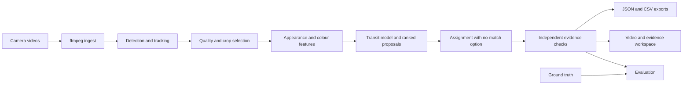

# MotoReID

Multi-Camera Motorcycle Re-Identification & Evidence Review.

The development fixture runs through tracking, cross-camera matching and independent verification. The browser workspace provides synchronized playback, evidence review, metrics, and JSON/CSV exports. CPU and GPU Docker images have passed offline fixture checks. See [PROGRESS.md](PROGRESS.md) for measured results and [BUILD_GUIDE.md](BUILD_GUIDE.md) for acceptance criteria.

## Stack

Python 3.11, FastAPI, Pydantic v2, React, TypeScript, Vite, Tailwind CSS and TanStack Query. The pipeline uses YOLO26 with YOLO11 fallback, BoT-SORT/ByteTrack, DINOv2, OpenCV, LightGlue/ALIKED with SIFT fallback, and SciPy assignment. Each run has its own filesystem directory.

## Development

Use Python 3.11 for the project environment:

```powershell
python -m venv .venv
.venv\Scripts\python -m pip install -e ".[dev]"
.venv\Scripts\python -m uvicorn app.main:app --host 127.0.0.1 --port 8080
```

In a second terminal:

```powershell
cd frontend
npm install
npm run dev
```

The generated `frontend/package-lock.json` locks frontend dependencies. Use `npm ci` for subsequent installs. The npm scripts invoke Node directly so Windows paths containing `&` work correctly.

## Docker

After starting Docker Desktop:

```sh
docker compose up --build
```

Open http://localhost:8080. Health endpoint: http://localhost:8080/api/health.

For an NVIDIA CUDA host with Docker GPU passthrough:

```sh
docker compose -f compose.yaml -f compose.gpu.yaml up --build
```

The build provisions YOLO26s, YOLO11s, DINOv2-small, ALIKED and LightGlue and generates the development fixture. User runs live on the mounted data volume. Use the development fixture for deterministic CPU evaluation with ground-truth tracks, dummy appearance embeddings and SIFT geometry.

On this development machine, an ignored `compose.override.yaml` selects the GPU image and NVIDIA
device reservation automatically, so `docker compose up -d --no-build` retains GPU operation.
Other fresh clones still default to CPU; use the two-file GPU command above there.
`/api/health` reports `device: cuda` when the container sees the GPU. Real-video stages select CUDA
automatically; the development fixture deliberately retains its CPU/dummy configuration.

The verifier caches up to `verifier.keypoints.cache_crops` crops and extracted features per run
(default 128, set 0 to disable). Cached arrays/features stay in CPU memory and are released after
each run. Resolution, keypoint limits and verification checks are unchanged. The GPU Compose
configuration sets OMP/MKL thread counts to 2, matching the validated workload.

On the RTX 3050, a controlled 30-pair cache comparison took 76.61 s uncached versus 27.73 s cached
(2.76×), with identical geometry and peak allocated CUDA memory of 1,743,222,272 bytes in both modes.
The full VnTraffic app job completed in 150.19 s versus the historical GPU run's 548.80 s (3.65×).
All 102 reviewed pairs retained their geometry, and Rank-1 stayed 3/17. This historical comparison
is not a CPU-versus-GPU benchmark; calibration/threshold tuning occurred between the full runs.
See [controlled benchmark](reports/gpu_keypoint_cache_benchmark.json) and
[full-run timing report](reports/gpu_full_run_speed.json). Reproduce the controlled comparison with:

```sh
python scripts/benchmark_keypoints.py --run data/user/runs/vntraffic-gpu \
  --out data/checks/keypoint-benchmark-next
```

## Checks

```sh
ruff check .
pytest -q
cd frontend
npm run build
```

The API test suite checks health, missing frontend handling, static assets, and unknown API routes. Model smoke tests use local assets and skip when those assets are unavailable.

With the Docker image built and the application running, Windows users can run
`& .\scripts\check_phase0.ps1` from the project root. This validates the frontend,
runs Ruff and pytest in a disposable Python 3.11 application container, and checks
the running HTTP endpoints. The transcript is saved to `data/checks/phase0.log`.
The script stops on errors and does not commit or push code.

## Data and credentials

### Synthetic development fixture (Phase 1)

After installing the project with Python 3.11 and installing ffmpeg, run:

```powershell
python scripts/make_dev_fixture.py --out data/fixtures/dev
```

Or use the existing application image against current source in PowerShell:

```powershell
docker compose run --rm --no-deps --volume "${PWD}:/workspace" --workdir /workspace -e PYTHONPATH=/workspace/backend app python scripts/make_dev_fixture.py --out data/fixtures/dev
```

This creates two 60-second H.264 videos, normalized GT CSVs and evaluation metadata.
Existing fixture outputs are never overwritten: choose a new output directory to regenerate.
There are 9 shared identities, 3 A-only identities, 2 B-only identities and 2 lookalike pairs.
Camera B has smaller sprites, a colour shift, blur and noise. Physical transit is 8–15 seconds;
the preset adds 4 seconds to B's camera timestamps. Metadata records truth for evaluation,
not as input to matching or clock estimation. The fixture uses full rider-and-bike rectangles;
it does not yet provide separate person detections.

`load_config("dev_fixture", overrides=...)` deep-merges defaults, a named preset and
per-run overrides, then validates the result. Set `MOTO_CONFIG_DIR` or pass `config_dir`
when loading config outside the source checkout. The Docker image includes the YAML files
and the generated fixture outside the mounted user-data directory.

`groundtruth.drop_rate`, `fragment_prob`, `fragment_gap_frames` and `confidence` control
the simulated detector. Fragmentation splits each selected track once, with a missing-frame
gap and collision-free replacement ID. Seeds come from `runtime.seed`.

Run `python -m pytest -q` and `ruff check .`, or use the existing container check helper
(`scripts/check_phase0_container.py`), which now discovers the Phase 1 tests too.
The encoding test uses small frames for speed; full-size generated videos were separately
verified with ffprobe. The frontend mirrors the backend contracts in `src/types.ts`.

### Storage policy

Do not commit recordings, model weights, generated run data, or secrets. Only explicitly attributed demo media under `samples/` may be committed. No paid API credentials are required.


### Track and crop pipeline (Phase 2)

Run `python scripts/run_pipeline.py --preset dev_fixture --fragment-prob 0.2`.
It writes a new directory under `data/user/runs/` containing `tracks_A.json`,
`tracks_B.json`, JPEG crops, browser-safe MP4s and `pipeline.json` with timings,
quality scores, dropped counts and detector provenance. Use `--out` for a specific
new directory. Existing runs are never overwritten.

Real detection uses locally provisioned YOLO weights only and falls back to the
configured second local model on failure. Runtime downloads and automatic tracker
dependency installation are disabled. Run the optional real-video test using
`MOTO_TEST_WEIGHTS` and `MOTO_TEST_VIDEO`; it skips when local assets are missing.
All `.env` and `.env.*` files are excluded from version control.

### Appearance representations (Phase 3)

The pipeline now also writes `representations/<track_id>.npz` with full, vehicle
and available rider embeddings, normalized mean embeddings, HSV histograms and
Lab colour means. Archives contain numeric arrays and are loaded with pickle disabled.
The fixture defaults to a deterministic histogram/spatial-statistics embedder.
DINOv2 concatenates CLS and mean patch tokens and uses CUDA FP16 autocast when available.
Its local weights must exist before execution; it never downloads at runtime.

Prepare a separate validation image (downloads occur only during Docker build):

```powershell
$applicationImage = docker compose images -q app
# For GPU validation add: --build-arg TORCH_VARIANT=cu124
docker build -f scripts/Dockerfile.dino-test --build-arg "APP_IMAGE=$applicationImage" -t motoreid-dino-test .
docker run --rm --network none --volume "${PWD}:/workspace" --workdir /workspace -e PYTHONPATH=/workspace/backend -e MOTO_CONFIG_DIR=/workspace/configs -e MOTO_DINO_MODEL=/opt/dinov2-small motoreid-dino-test python -m pytest tests/test_phase3.py -q
```

For a GPU-enabled validation image, run the full selected-crop memory benchmark:

```powershell
docker run --rm --network none --gpus all --volume "${PWD}:/workspace" --workdir /workspace -e PYTHONPATH=/workspace/backend -e MOTO_CONFIG_DIR=/workspace/configs motoreid-dino-test python scripts/check_dino_gpu.py --run data/user/runs/phase2-validation --model /opt/dinov2-small --out data/checks/dino-gpu.json
```

Use your existing fixture run path for `--run` and `MOTO_TEST_RUN` if different.
The benchmark defaults to Python 3.11. For the approved benchmark-only Python 3.12 environment, pass `--allow-python312-benchmark`. The limit is 3 GiB peak allocated CUDA memory.
DINOv2 can prefer a wrong synthetic lookalike. In the review workspace, compare the transit time, vehicle and rider features, geometric inliers, and competing pairs before interpreting a proposal.

## Architecture



## Using the workspace

Choose Development fixture on the home page and start a run. Processing status updates automatically.
Select a query track, then a candidate to seek each video to that track. Play both advances the videos
together while preserving the selected pair's travel-time separation. The B offset control adjusts
playback alignment without changing the stored analysis. Use the presence timeline to navigate.

Review the crop strips, geometric match image, vehicle/rider similarities and evidence. Status text
accompanies each colour. Ambiguity and competing claims are visible even for high combined scores.
The Metrics tab shows retrieval, decision and calibration measures. Export links download the full
result, all ranked candidates, or one row per query.

## Configuration reference

Defaults live in configs/default.yaml. Presets deep-merge into them, followed by per-run overrides.

| Group | Main controls |
|---|---|
| detector | Local primary/fallback weights, device, confidence, resize height and processing stride |
| tracker | Tracker choice, minimum frames, stitching time/motion/appearance gates |
| crops | Top K, pixel height, temporal diversity and quality weights |
| embedding | Dummy or DINO backend, batch size and part features |
| topology | Direction, transit interval, expected motion and clock offset |
| matching | Score weights, top N, no-match threshold and ambiguity margin |
| verifier | Geometry thresholds, part/colour/quality thresholds and decision probabilities |
| evaluation | IoU threshold, identity vote fraction and calibration bins |

Clock estimation uses visually confident mutual-best pairs and an explicitly configured expected
travel time. The fixture prior is 11.5 seconds, the midpoint of its declared 8–15 second travel
distribution. Without a prior, clock alignment is unreliable and the transit window widens.
For synchronized cameras, supply a measured fixed offset.

Candidate scores combine appearance, colour, transit and motion. Hungarian assignment enforces
one-to-one proposals within each direction and includes a no-match option. Geometrically impossible
timing cannot win assignment, even when a visually similar candidate is retained for review.

The verifier recomputes evidence from crop features, timestamps, motion and geometry. It applies
critical timing rejection before probability thresholds. High-severity contradictions and ambiguity
prevent acceptance. Coefficients in configs/calibrator.json are fitted from fourteen tuning pairs
using logistic regression. Their small training sample limits probabilistic interpretation.

## Export format

Each run contains results.json validated by RunResult in backend/app/schemas.py, tracks with normalized
boxes, selected JPEG crops, representations, browser MP4s, geometry images and pipeline timings.
The compact API result omits boxes; the per-camera tracks endpoint includes them.

candidates.csv includes IDs, rank, assignment, component scores, raw and adjusted transit times,
ambiguity, verdict, confidence, evidence and summary. queries.csv contains the query outcome and
best candidate. Undefined metrics are null. Accepted-only metrics and metrics treating uncertain
decisions as positive are reported separately.

## Test commands

```sh
python -m ruff check .
python -m pytest -q -m "not slow"
python -m pytest -q
cd frontend
npm ci
npm run build
```

The fast suite excludes model and API fixture integration tests. Full model checks require local
weights and videos. Every runtime loader uses local assets. Docker downloads occur during build.
scripts/check_offline_image.py verifies the packaged UI and fixture from inside a running container.
Run it with docker exec against an image started with --network none.

## Evaluation and limitations

| Dataset / evaluation | Accepted precision | Recall | F1 | Rank-1 | Correct rejection | False accepted | ECE | Detection FPS A/B | Hardware |
|---|---|---|---|---|---|---|---|---|---|
| Development fixture, full regression | N/A | 0 | 0 | 1.00 (9/9) | 1.00 (3/3) | 0 | 0.261 | N/A (GT detector) | Ryzen 7 5800H CPU |
| VnTraffic synthetic, motorcycle detector, held-out | N/A | 0 | 0 | 0.167 (2/12) | 1.00 (3/3) | 0 | 0.290 | 18.01 / 17.24 | RTX 3050 Laptop 4 GB |
| RoundaboutHD cameras 1/2, all vehicles, held-out | N/A | 0 | 0 | 0.714 (10/14) | 1.00 (12/12) | 0 | 0.164 | 19.03 / 29.11 | RTX 3050 Laptop 4 GB |
| RoundaboutHD motorcycle subset | N/A | N/A | N/A | N/A | N/A | N/A | N/A | N/A | Class mapping unverified |

No GT-mapped held-out queries were accepted, so precision is undefined rather than 100%. Correct rejection permits
uncertain outcomes, as required by the guide. RoundaboutHD's statistics workbook has no
motorcycle-labelled rows, but its local SCT IDs are not assumed to be global IDs. VnTraffic's GT
has no classes; its row evaluates motorcycle-detector tracks against available identity boxes.
Fifty-four RoundaboutHD and eleven VnTraffic queries could not be mapped to GT and are excluded.
The original RoundaboutHD baseline has one accepted unmapped query (A-0002 to B-0052);
its correctness is unknown and it is not counted as either a true or false accepted match.
Candidate-level verdicts can also differ from the query's final assigned outcome.
See [RoundaboutHD held-out metrics](reports/roundabouthd_pair_held_out_metrics.md),
[VnTraffic held-out metrics](reports/vntraffic_synth_held_out_metrics.md),
[fixture metrics](reports/dev_fixture_calibrated_metrics.md), and
[three screenshot-backed near-misses](docs/near_misses.md).

Real-data evaluation replays frozen raw verifier features with learned coefficients and tuned
thresholds. Assignment is recomputed within each query split. The displayed FPS comes from the
actual source YOLO pipelines, whose total wall times were 530.1 s (RoundaboutHD, two 60 s clips)
and 548.8 s (VnTraffic, 17 s A and 35 s B including blank delay). These are detection throughput,
not end-to-end real-time claims. The fixture rerun with fitted coefficients took 17.3 s.

The fixture has limited viewpoint variation and no separate rider annotations. Its detector uses
ground truth and its appearance encoder is deterministic. Real-data estimates use small held-out splits.
DINOv2 has no motorcycle-specific training here. Small vehicles lose detail when 4K footage is
downscaled. Rider posture and passenger changes can contradict vehicle similarity. A missing rider
or weak geometry contributes uncertainty. Fourteen calibration pairs are insufficient to establish
reliable confidence probabilities across cameras or deployment conditions.
The transit model assumes non-overlapping journeys; simultaneous visibility or parked vehicles
in overlapping views can trigger timing contradictions even with strong geometric agreement.

GPU validation used an RTX 3050 Laptop 4 GB, Python 3.11.18 and PyTorch 2.6.0+cu124. DINO processed
368 crops with batch size 32 at 290.3 MiB peak allocated memory. This measurement excludes driver
reservation and other GPU processes.

Phase 10 training follows [the documented protocol](docs/training_protocol.md): fit logistic
verifier calibration, tune the four specified thresholds on tuning queries, then report held-out
results. Neural model weights stay pretrained. The pooled fit has five positive and nine negative
training pairs; its coefficients and per-preset thresholds are saved in configs/. The
[labelled baseline report](reports/vntraffic_baseline_labelled_metrics.md) excludes eleven unmapped
queries. It describes all labelled baseline queries, not held-out trained-model performance.

VnTraffic samples derive from [Thi-Nhung Le and contributors' Vehicle Tracking Dataset](https://zenodo.org/records/18195750),
CC BY 4.0, with source video credited by its authors to HTV, Hanoi Radio and Television Station.
See [sample attribution and modifications](samples/vntraffic_synth/README.md). Its supplied source
lasts 17 seconds and supplies identity boxes without vehicle-class labels. The synthetic pair
therefore cannot provide 60 seconds of distinct source footage or independent viewpoints.

## Credits and licenses

| Component | Upstream license / source |
|---|---|
| Ultralytics YOLO | [AGPL-3.0](https://github.com/ultralytics/ultralytics/blob/main/LICENSE) |
| DINOv2 | [Apache-2.0](https://github.com/facebookresearch/dinov2/blob/main/LICENSE) |
| LightGlue | [Apache-2.0](https://github.com/cvg/LightGlue/blob/main/LICENSE) |
| ALIKED | [BSD-3-Clause](https://github.com/Shiaoming/ALIKED/blob/main/LICENSE) |
| VnTraffic | [CC BY 4.0 dataset record](https://zenodo.org/records/18195750); attribution above |
| RoundaboutHD | [Authors' dataset card](https://huggingface.co/datasets/yl4300/RoundaboutHD); no license declaration found in the inspected card/archive README |

RoundaboutHD raw videos and annotations remain local and are not redistributed in this repository.
See [the 4:20 demo script](docs/demo_script.md) for the presentation sequence and measured limitations.
The completed local captioned demo is `data/demo/render-v2/moto-reid-demo.mp4` (not committed).
See [final validation and remaining limits](docs/final_checks.md) for the fresh-clone/offline check,
test timings, demo verification and artifact locations.
For a complete record of the implemented work, measurements, validation and known limitations, see
[the actual work completed report](docs/ACTUAL_WORK_COMPLETED.md).
