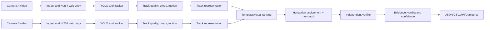

# Actual implementation report

**Project:** Multi-Camera Motorcycle Re-Identification & Evidence Review  
**Report date:** 9 November 2026  
**Specification:** `BUILD_GUIDE.md`  
**Current GitHub revision:** `d131a45` on `main`  
**Application:** http://localhost:8080 (configured locally for CUDA)

This report describes the work that was actually implemented, tested, measured,
and retained in the repository. It separates committed source and reports from
local-only data, models, videos, Docker images, and generated run artifacts.

## 1. Delivered system

MotoReID accepts two camera videos, detects and tracks target vehicles, creates
track-level representations from selected crops, ranks cross-camera candidates,
applies one-to-one assignment with an explicit no-match alternative, verifies
ranked candidates independently, and presents results through a web workspace.

The delivered system includes:

- A FastAPI backend, React/TypeScript frontend, Python 3.11 package, Docker
  CPU and GPU configuration, and browser-safe H.264 video serving.
- YOLO26s detection with YOLO11s fallback, BoT-SORT or ByteTrack selection,
  DINOv2 track representations, HSV/Lab colour features, ALIKED/LightGlue
  geometric verification with SIFT fallback, and SciPy Hungarian assignment.
- A deterministic synthetic two-camera development fixture for repeatable tests.
- Real-data preparation and evaluation workflows for VnTraffic and RoundaboutHD.
- A local 4 minute 20 second captioned demo walkthrough and a documented demo
  script.
- Structured run outputs: JSON, CSV, cropped images, geometry previews,
  representations, browser MP4 copies, logs, metrics and timing information.

## 2. Architecture and processing flow



The system stores normalized bounding boxes outside the detector module. Pure
matching, temporal, verifier-policy, and metrics logic remains free of Torch and
OpenCV imports for unit testing.

## 3. Work completed by phase

### Phase 0 — foundation

Implemented the repository skeleton, Python packaging, Pydantic configuration
models, FastAPI app, health endpoint, React/Vite/TypeScript frontend, Docker
CPU/GPU Compose files, static frontend serving, basic API tests, and validation
scripts.

The frontend build was made robust on Windows paths containing `&` by invoking
TypeScript and Vite through Node rather than generated shell shims.

### Phase 1 — configuration, schemas and fixture

Implemented deep-merged YAML presets, typed schema validation, normalized data
models, and a deterministic development fixture:

- Two H.264 videos, 640×360, 15 FPS, 60 seconds each.
- Fourteen identities: 9 shared, 3 Camera-A-only, 2 Camera-B-only, and two
  lookalike pairs.
- Camera B has scale, colour, blur and a +4-second clock offset.
- Physical transit times are sampled from 8–15 seconds.
- GT detector mode reads normalized CSV boxes, supports controlled dropped
  detections and track fragmentation, and never reads fixture truth metadata
  during simulation.

### Phase 2 — track pipeline

Implemented:

- FFprobe metadata extraction and browser-safe H.264 conversion.
- YOLO tracking adapter with local-weight fallback and provenance recording.
- Ground-truth detector for development and tests.
- Rider association, track stitching, normalized geometry, motion vectors, crop
  quality scoring, top-K diverse crop selection, track quality scoring, and
  per-stage timing.
- CLI orchestration in `scripts/run_pipeline.py`.

The integrated fixture run produced 12 Camera-A and 11 Camera-B tracks with
fragmentation enabled.

### Phase 3 — representations

Implemented HSV/Lab colour features and two embedding modes:

- `DummyEmbedder`: deterministic histogram/spatial-colour/contrast features
  for tests and the development fixture.
- `DinoEmbedder`: local-only DINOv2-small CLS plus mean-patch token features,
  unit-normalized and stored as numeric NPZ arrays with pickle disabled.

Real DINO aggregate evaluation over shared fixture identities produced mean
same-identity similarity 0.849213 and mean different-identity similarity
0.803248. It is not perfect for every individual pair; that limitation is
retained in project documentation.

The RTX 3050 memory benchmark processed 368 crops at batch size 32 with
304,356,864 allocated CUDA bytes (290.3 MiB), below the project 3 GiB target.

### Phase 4 — temporal matching and assignment

Implemented:

- Clock-offset estimation with a documented travel-time prior.
- Gaussian-density diagnostic, soft travel-time score, direction score,
  visual/colour score composition, and ranked candidate generation.
- Hungarian one-to-one assignment with a separate dummy/no-match choice.
- Ambiguity flags and competing candidate references.
- Candidate export to `candidates.json`.

The fixture estimates +3.567 seconds for a known +4 second offset. It gets
Rank-1 for all 9 shared fixture queries, selects no match for two of the three
A-only queries, and flags the designed lookalikes.

The travel-time prior was explicitly approved because clock offset and travel
time are otherwise not identifiable from the specified observations alone.

### Phase 5 — independent verifier

Implemented independent checks based on:

- Full, rider and vehicle embeddings.
- Grey-world corrected Lab colour distance and histogram similarity.
- Timing, clock reliability, motion, track quality and missing data.
- LightGlue + ALIKED local geometric matching, with OpenCV SIFT fallback.
- Evidence entries with support/contradiction/missing polarity and severity.
- Logistic calibrated probability, accepted/uncertain/rejected policy, readable
  verdict summary, and per-query outcome resolution.

The verifier reviews the configured top 3 candidates rather than only the
assigned leader. It saves geometry previews and records any fallback.

### Phase 6 — API, jobs, exports and evaluation

Implemented:

- Single-worker background jobs with atomic status updates.
- SHA-256 reuse cache that includes videos, GT, config and calibration content.
- Preset submission and video upload endpoints.
- Run history, compact/full result routes, track routes, download routes and
  HTTP Range support for media.
- Schema-validated `results.json`, `candidates.csv` and `queries.csv`.
- IoU-vote mapping of predicted tracks to GT identities.
- Retrieval, decision, false-match, ROC-AUC and 10-bin ECE metrics.

### Phase 7 — frontend review workspace

Implemented the production frontend:

- Preset and upload start form, run history and progress.
- Side-by-side synchronized playback with timestamp offset controls.
- Frame-indexed normalized box overlays.
- Presence timelines and track selection.
- Ranked candidates, crop comparison, geometry preview, evidence list,
  competing claims, verdicts and metrics.
- JSON and CSV download controls.

Manual browser validation confirmed synchronized playback, overlays, selection,
evidence, metrics, and all three downloads.

### Phase 8 — offline CPU/GPU packaging

Implemented build-time provisioning of YOLO, DINOv2-small, ALIKED and LightGlue,
baked development fixture creation, health check, CPU/GPU Compose support, and
offline model loading.

Validated:

- Fresh CPU image completes the fixture under `--network none`.
- Fresh GPU service reports `device: cuda`.
- DINO loads as the unprivileged `moto` runtime user.
- GPU CUDA tensor operation runs on the RTX 3050.
- Full Python 3.11 suite passed with actual YOLO inference available.

### Phase 9 — hardening and documentation

Added test coverage for crop quality/diversity, colour similarity, stitching,
export quoting/empty queries, hand-computed metrics, and calibration
load/save. Expanded README with architecture, configuration, matching,
verification, exports, tests, limitations and Docker use.

### Phase 10 — real datasets, evaluation and calibration

Implemented data preparation utilities:

- `scripts/download_data.py` downloads into ignored
  `data/user/datasets/`, resumes safely, validates archives, and rejects
  unsafe ZIP paths.
- `scripts/make_synthetic_pair.py` creates VnTraffic Camera A/B overlap crops,
  B delay, resize, colour temperature/gamma shift, blur, JPEG artifacts, GT
  conversion and attributed samples.
- `scripts/convert_roundabouthd.py` reads the dataset's actual annotation
  spelling (`Multi_CAM_Ground_Turth.txt` as well as the expected spelling),
  creates selected camera pairs and normalized GT, estimates a transit window
  from tuning identities only, and records class-mapping uncertainty.
- Real-data presets are listed by the web UI when their local inputs exist.

Actual datasets and processing:

| Dataset | Input / configuration | Actual result |
|---|---|---|
| VnTraffic synthetic pair | 17-second source, A left 55% crop, B right 55% crop, 18-second video delay, +6 s configured clock offset | 34 A tracks, 46 B tracks |
| RoundaboutHD cameras 1/2 | Two 60-second extracted clips; 22.068–35.592 s transit window; fixed 0 s source synchronization assumption | 53 A tracks, 38 B tracks |

The VnTraffic source is only 17 seconds and has identity boxes without class
labels. Its committed sample honestly retains that limitation rather than
inventing 60 seconds of distinct material. RoundaboutHD's vehicle workbook uses
local SCT IDs and is not treated as a global cross-camera class mapping.

Calibration implementation:

- `scripts/fit_calibrator.py` fits scikit-learn logistic regression to the
  verifier's ten feature values.
- Identity-level SHA-256 parity creates tuning/held-out partitions.
- Both roles in a fitting pair must be tuning identities, preventing held-out
  identities from entering training pairs.
- `min_match_score`, `ambiguity_margin`, `p_accept`, and `p_reject`
  are selected on tuning queries only.
- Coefficients are JSON, never pickle.
- Pretrained YOLO, DINOv2, ALIKED and LightGlue weights are not fine-tuned.

The final pooled fit contains 14 labelled tuning pairs: 5 positive and 9
negative. RoundaboutHD supplies 10 pairs and VnTraffic supplies 4.

Held-out evaluation:

| Dataset | Accepted precision | Recall / F1 | Rank-1 | Correct rejection | ECE | Important caveat |
|---|---:|---:|---:|---:|---:|---|
| Development fixture | Undefined | 0 / 0 | 9/9 | 3/3 | 0.261 | Uses GT detector/dummy embedding |
| VnTraffic synthetic | Undefined | 0 / 0 | 2/12 | 3/3 | 0.290 | 11 queries unmapped and excluded |
| RoundaboutHD 1/2 | Undefined | 0 / 0 | 10/14 | 12/12 | 0.164 | 54 queries unmapped and excluded |

No GT-mapped held-out query was accepted. Thus precision is undefined, not
100%, and accepted recall/F1 are zero. Threshold combinations tied at zero
accepted F1, so selected values are first-tied grid choices, not claimed
optimal settings.

### Phase 11 — demo and final validation

Created:

- `docs/demo_script.md`: a 4:20 presenter script.
- `scripts/build_demo.py`: captioned demo assembly helper.
- `docs/final_checks.md`: final validation evidence and remaining limits.
- Local demo: `data/demo/render-v2/moto-reid-demo.mp4`, H.264, 1280×900,
  15 FPS, exactly 260 seconds, no audio. It is intentionally ignored because
  it includes local review content; it was fully decoded and visually checked.

The demo includes real playback, a correct-but-uncertain VnTraffic retrieval,
two near-misses, no-reliable-match behavior, clock offset explanation, metrics,
exports, and an actual RoundaboutHD timing rejection.

## 4. Evidence case studies

Three documented VnTraffic baseline near-misses are in
`docs/near_misses.md` with committed screenshots:

1. **Correct but uncertain:** A-0000 → B-0018 maps to identity 39 in both
   cameras. It has 40 geometric inliers but conflicting candidate/assignment
   evidence, so it remains uncertain.
2. **Wrong top candidate withheld:** A-0006 maps to identity 44 while its
   leader B-0018 maps to identity 39. Visual score is high, but vehicle-part
   evidence is weaker and geometry has zero inliers. It remains uncertain.
3. **Correct identity at rank 2:** A-0017's true identity is B-0035, but
   B-0013 ranks first. The incorrect leader remains uncertain because it lacks
   rider crops and geometric support.

RoundaboutHD also has a real rejected proposal A-0000 → B-0039. It has 60
geometric inliers, but -33.9 seconds adjusted transit, which is a critical
timing contradiction. This demonstrates the transit rule but does not prove
that the vehicles are distinct, because cameras may have overlapping views.

## 5. GPU activation and speed work

The local app at http://localhost:8080 is configured to use the RTX 3050 Laptop
GPU. The machine-local `compose.override.yaml` is intentionally ignored so
other users/clones retain CPU defaults. The tracked `compose.gpu.yaml` remains
the portable GPU option.

Implemented a bounded verifier cache:

- `verifier.keypoints.cache_crops: 128` in `configs/default.yaml`.
- Caches grayscale crop pixels plus ALIKED or SIFT feature results in CPU memory
  during one run.
- Copies learned features back to CUDA only when matching requires them.
- Uses LRU eviction and releases cache/model resources after verification.
- A value of 0 disables caching.
- It does not reduce image resolution, model, keypoint count, candidate count,
  or verification checks.

Measured results on RTX 3050 Laptop GPU, Python 3.11.18 and PyTorch 2.6.0+cu124:

| Measurement | Before | After | Result |
|---|---:|---:|---|
| Controlled 30-pair verifier benchmark | 76.610 s | 27.728 s | 2.763× faster |
| Peak allocated CUDA memory | 1,743,222,272 bytes | same | No additional peak allocation |
| Geometry values and preview PNGs | baseline | cached | all 30 identical |
| VnTraffic full app run | 548.804 s | 150.189 s | 3.654× historical improvement |
| VnTraffic verification stage | 471.031 s | 76.606 s | 6.149× historical improvement |

The full historical comparison is not a controlled CPU-vs-GPU measurement:
calibration/threshold work occurred between those two runs. The 30-pair
benchmark is the controlled equivalence/speed evidence.

The faster full run retained 34 A and 46 B tracks, reviewed the same 102
candidate pairs, used LightGlue for all 102, recorded no fallback notes,
preserved all geometry values, and retained Rank-1 = 3/17.

## 6. Validation record

Latest recorded validations:

| Check | Result |
|---|---|
| Python version | 3.11.18 for the project/test containers |
| Full pytest after GPU cache work | 59 passed in 56.13 seconds |
| Fast pytest suite | 56 passed in 21.66 seconds; 3 slow tests deselected |
| Ruff | Passed |
| TypeScript/Vite production build | Passed |
| Fresh offline CPU image | Baked fixture completed under `--network none`, 12 queries, Rank-1 1.0 |
| Updated CUDA image | Baked fixture completed under `--network none`, reports CUDA, 12 queries, Rank-1 1.0 |
| Main application health | `/api/health` returns `device: cuda` |
| Exports | JSON, candidates CSV and queries CSV downloaded via browser |
| Browser playback | Paired real-video playback, normalized overlays, seeking, evidence and metrics verified |
| Demo output | Full ffmpeg decode passed; metrics and rejection frames visually checked |

## 7. Repository and publication status

GitHub `main` currently points to:

```
d131a45 perf: cache verifier features and enable local GPU app
```

Relevant later commits:

| Commit | Purpose |
|---|---|
| `4cd6aeb` | Demo script, final validation record and demo builder |
| `22196a3` | Pooled calibration and held-out evaluation reports |
| `41f350b` | Real dataset preparation and calibration protocol |
| `cdeff1d` | Test hardening and README acceptance |
| `ba2275b` | Offline CPU and Python 3.11 CUDA packaging acceptance |

The following are deliberately not committed:

- Raw datasets, run outputs, model weights, local Docker images and caches.
- Full demo video and raw browser captures in `data/`.
- Environment files, including `.env` variants.
- The machine-specific `compose.override.yaml` that selects GPU hardware.
- The pre-existing empty untracked file `=8,`, which has been preserved
  untouched.

Allowed VnTraffic sample MP4 files under `samples/vntraffic_synth/` are
committed with attribution and CC BY 4.0 provenance.

## 8. Important limitations and honest interpretation

1. Calibration training is very small: 14 pairs, only 5 positive. This is not
   sufficient to establish reliable deployment probabilities.
2. No GT-mapped held-out query was accepted. The system demonstrates abstention
   and evidence, but not successful accepted-match recall on real held-out data.
3. The original RoundaboutHD baseline includes one accepted *unmapped* query
   (A-0002 → B-0052). Its correctness is unknown and it is excluded from all
   scored metrics; it must not be described as a true accepted match.
4. Query identities are held out, but candidate galleries are shared. These are
   not separate-camera generalization benchmarks.
5. VnTraffic derives both cameras from one source view, so it has limited
   viewpoint diversity. It lacks vehicle classes and has only 17 seconds of
   source footage.
6. RoundaboutHD vehicle categories are local SCT metadata, not verified global
   cross-camera labels. Motorcycle-subset metrics are therefore unavailable.
7. Timing assumes non-overlapping journeys. Simultaneously visible or parked
   vehicles can produce a timing rejection despite strong visual geometry.
8. DINOv2 is not motorcycle-specific. Rider/posture/passenger changes,
   occlusion, small vehicle crops, 4K downscaling and ID fragmentation remain
   significant sources of uncertainty.
9. The app works offline after Docker build, but weights must be provisioned
   during that build. Runtime network use is disabled for packaged validation.

## 9. How to reproduce core work

```sh
# CPU application
docker compose up --build

# GPU application on an NVIDIA Docker host
docker compose -f compose.yaml -f compose.gpu.yaml up --build

# Python checks
python -m pytest -q
python -m pytest -q -m "not slow"
ruff check .
cd frontend && npm run build

# Controlled GPU verifier cache comparison
python scripts/benchmark_keypoints.py \
  --run data/user/runs/vntraffic-gpu \
  --out data/checks/keypoint-benchmark-next

# Assemble local demo from captured input and evidence
python scripts/build_demo.py \
  --capture data/demo/capture \
  --out data/demo/render-next
```

Use fresh output paths for data-producing commands. The report and code do not
overwrite existing raw datasets, runs, models or user files.

## 10. Key report/document locations

- `README.md` — run instructions, architecture, results table and license credits.
- `PROGRESS.md` — chronological phase-by-phase implementation and validation log.
- `docs/training_protocol.md` — calibration and split methodology.
- `docs/near_misses.md` — documented evidence cases and screenshots.
- `docs/demo_script.md` — 4:20 presentation sequence.
- `docs/final_checks.md` — final Docker/demo/test validation.
- `reports/gpu_keypoint_cache_benchmark.json` — controlled cache benchmark.
- `reports/gpu_full_run_speed.json` — end-to-end speed comparison.
- `reports/*held_out_metrics.*` and `reports/*training_manifest.json` —
  real-data calibration/evaluation provenance.

