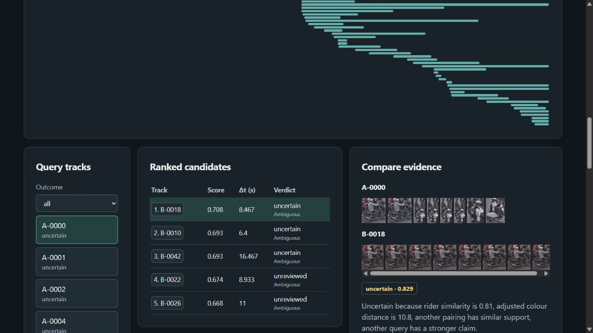
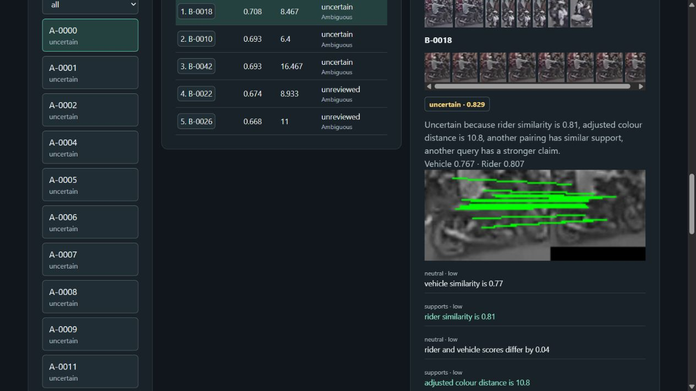
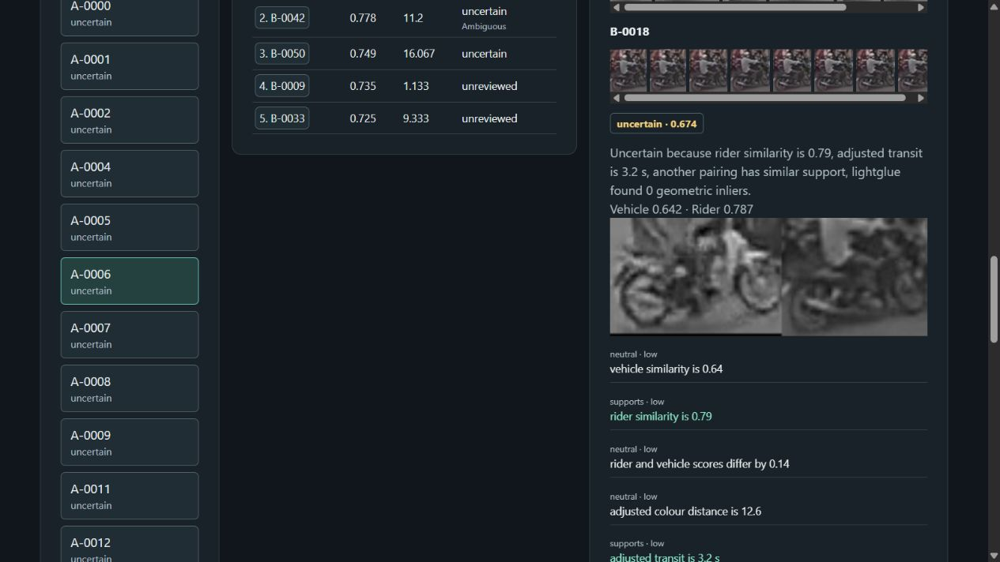
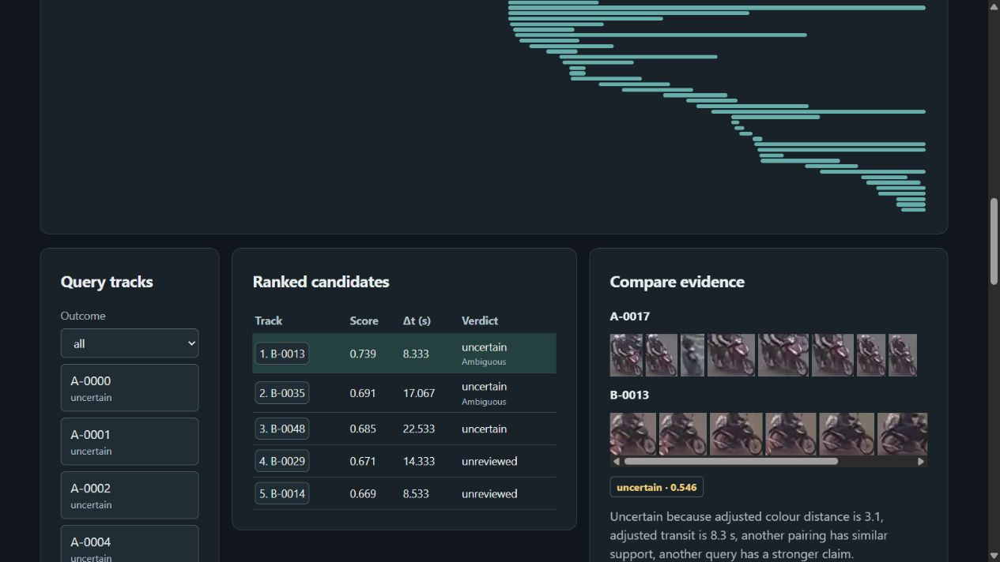

# VnTraffic baseline near-misses

These are observed cases from `data/user/runs/vntraffic-gpu`, using the original
hand-set calibration. They illustrate errors and abstention; they are not
held-out performance claims for the final trained model. Identities below come
from annotation IoU voting, not visual guesses. No pair in this baseline was
accepted, so these are near-misses rather than false accepted matches.

The screenshots contain modified VnTraffic footage from Thi-Nhung Le and
contributors' [Vehicle Tracking Dataset](https://zenodo.org/records/18195750),
CC BY 4.0. Its authors credit the source video to HTV, Hanoi Radio and Television
Station. Modifications: overlapping camera crops, synthetic delay, degradation,
downscaling and evidence UI overlays. See the sample attribution for details.

## 1. Correct identity, but competing claims prevent acceptance

`A-0000 → B-0018` maps to identity 39 in both cameras. It ranks first with
combined score 0.708, verifier probability 0.829 and 40 LightGlue geometric
inliers. Nevertheless, competing candidates and another query's stronger claim
make the verdict **uncertain**. The same identity also appears at rank 3
(`B-0042`), consistent with fragmentation. Strong geometry and a high provisional
probability do not resolve the assignment conflict.

## 2. A visually strong wrong candidate is withheld

`A-0006` maps to identity 44; its first-ranked `B-0018` maps to identity 39.
The matcher gives visual similarity 0.830 and combined score 0.805. The independent
vehicle-part similarity is only 0.642, and LightGlue finds zero geometric inliers.
The provisional probability is 0.674, with competing candidates flagged. The
verdict stays **uncertain**, preventing this wrong first-ranked proposal from
becoming a false accepted match. The true identity is absent from the top five.

## 3. Correct identity loses first rank

`A-0017` maps to identity 46. The first-ranked `B-0013` is identity 23, while
the correct `B-0035` is second. Combined scores are 0.739 and 0.691: their small
gap triggers ambiguity under the baseline margin. The wrong leader has zero
geometric inliers, missing rider crops, probability 0.546 and a competing query
claim. It remains **uncertain**. This is a Rank-1 failure even though Rank-5
retrieval contains the correct identity; abstention does not repair retrieval.

## Reproduce the review

The preserved UI copy has run ID `5d25ad36e97a46c89684f030f663ee10` in `data/runs/`.
Open it in the run history and select A-0000, A-0006 and A-0017 respectively.
Its metrics use the corrected labelled-query denominator. Raw source run and
previous exports remain preserved. Dataset-dependent artifacts are not bundled
in Git; the screenshots provide a portable record of these observations.
